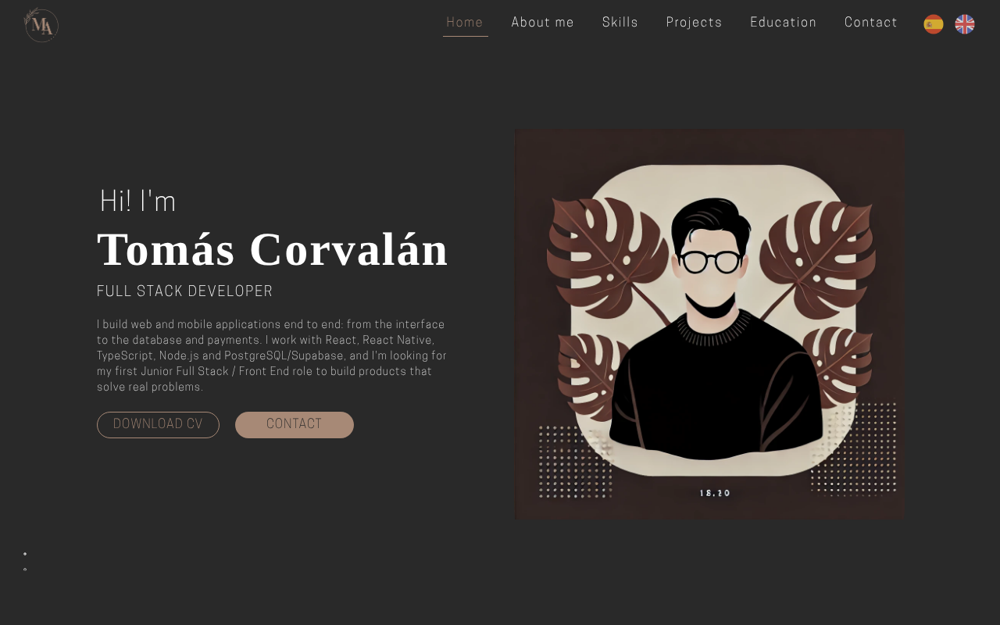
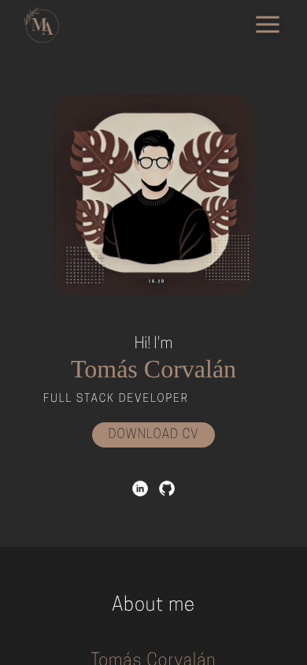

# Portafolio — Tomás Corvalán

Portafolio personal de **Tomás Corvalán**, desarrollador Full Stack (React, React Native, TypeScript, Node.js, PostgreSQL/Supabase, Stripe) basado en Valparaíso, Chile.

**Sitio en vivo:** https://portafolio-ten-alpha-63.vercel.app/



<p align="center"></p>

## Qué incluye

- Sitio **bilingüe (ES/EN)** con selector de idioma; recuerda la elección del visitante y actualiza el atributo `lang`.
- **Responsive** (móvil, tablet y escritorio) con hojas de estilo por breakpoint.
- **Accesible:** un solo `h1`, jerarquía de títulos, enlace "saltar al contenido", navegación por teclado en menú e idioma, textos alternativos y foco visible.
- **SEO y compartir:** meta tags, Open Graph / Twitter Card con imagen 1200×630, URL canónica y datos estructurados JSON-LD (`Person`).
- **Rendimiento:** imágenes en WebP con `loading="lazy"` y dimensiones declaradas (el peso del repositorio bajó de ~32 MB a ~1 MB).
- **Formulario de contacto** que funciona sin backend: abre el correo del visitante con el mensaje redactado, o envía vía [Web3Forms](https://web3forms.com) si se configura una clave.
- **Calidad automatizada:** ESLint, Prettier, validación de HTML y chequeo de consistencia de traducciones, ejecutados en GitHub Actions en cada push.

## Stack

| Área       | Tecnologías                                     |
| ---------- | ----------------------------------------------- |
| Sitio      | HTML5, CSS3, JavaScript (sin frameworks)        |
| Librerías  | AOS (animaciones), Font Awesome                 |
| Calidad    | ESLint, Prettier, html-validate, GitHub Actions |
| Despliegue | Vercel                                          |

## Estructura

```text
.
├── index.html            # Página única (secciones: inicio, sobre mí, habilidades, proyectos, formación, contacto)
├── script.js             # Menú, idioma, formulario, scroll
├── languages/            # es.json y en.json (mismas claves)
├── assets/
│   ├── images/           # Imágenes optimizadas e íconos (skills/ = íconos SVG de Devicon)
│   ├── fonts/
│   └── stylesheet/       # index.css (móvil) + tablet.css + desktop.css
├── scripts/check-i18n.mjs
└── .github/workflows/ci.yml
```

## Ejecutar en local

```bash
npm install
npm start          # sirve el sitio en http://localhost:5501
npm run check      # lint + formato + validación HTML + chequeo de traducciones
```

## Formulario de contacto

Por defecto, al enviar se abre el cliente de correo del visitante (`mailto:`). Para recibir los mensajes directamente:

1. Genera una _access key_ gratuita en [web3forms.com](https://web3forms.com) con tu correo.
2. Pégala en `WEB3FORMS_ACCESS_KEY` al inicio de `script.js`.

## Pendientes

- [ ] Agregar 2–3 capturas reales de **Recuerda Med** y el enlace a Google Play cuando esté publicada.
- [ ] Publicar el repositorio de **Babies Marketplace** y activar su botón REPO en `index.html`.
- [ ] Agregar una foto profesional en la sección de inicio.

## Créditos

- Íconos de tecnologías: [Devicon](https://devicon.dev) (licencia MIT, ver `assets/images/skills/LICENSE-devicon.txt`).
- Diseño y código: Tomás Corvalán.
